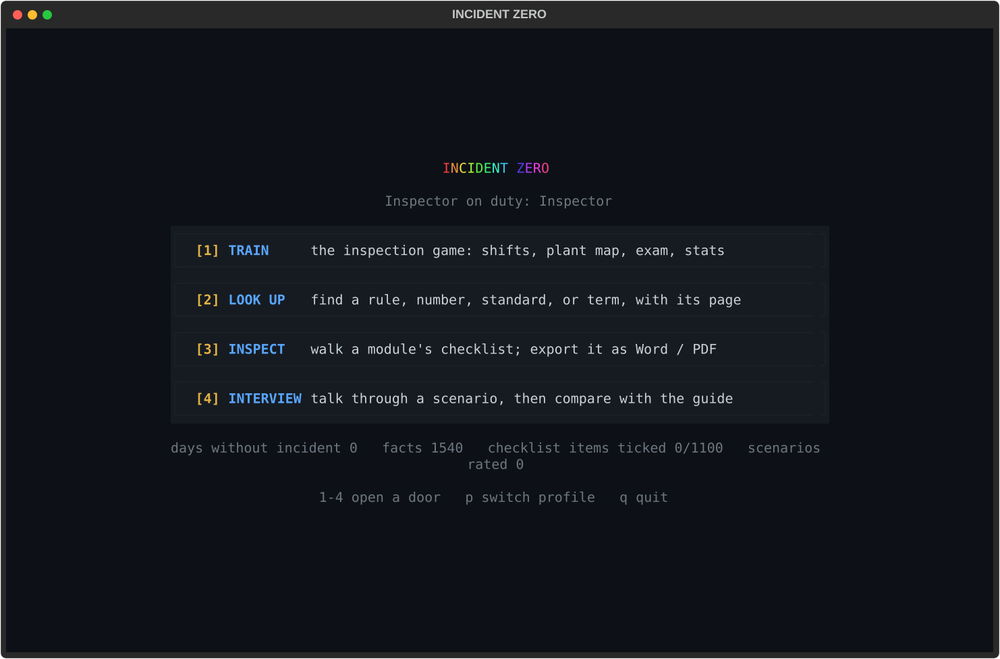
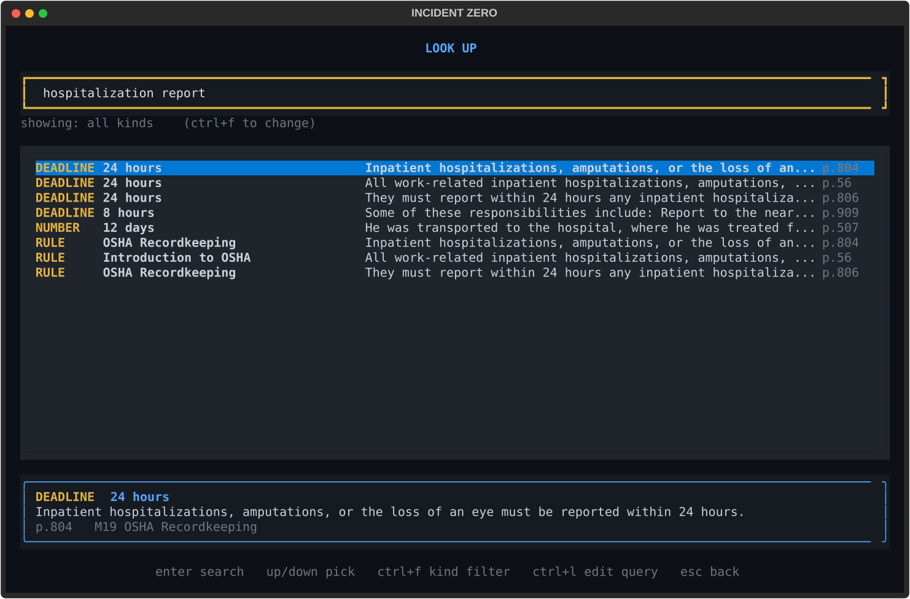
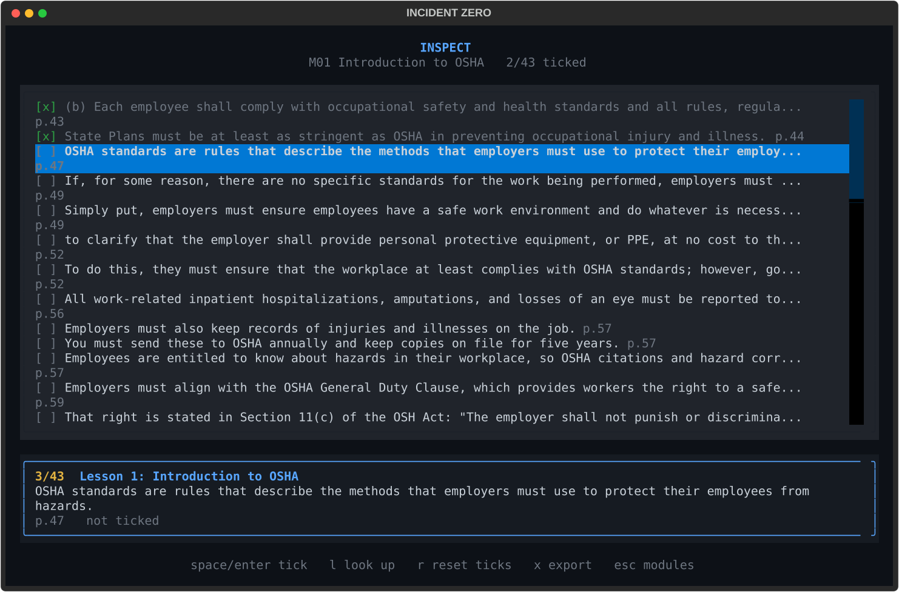
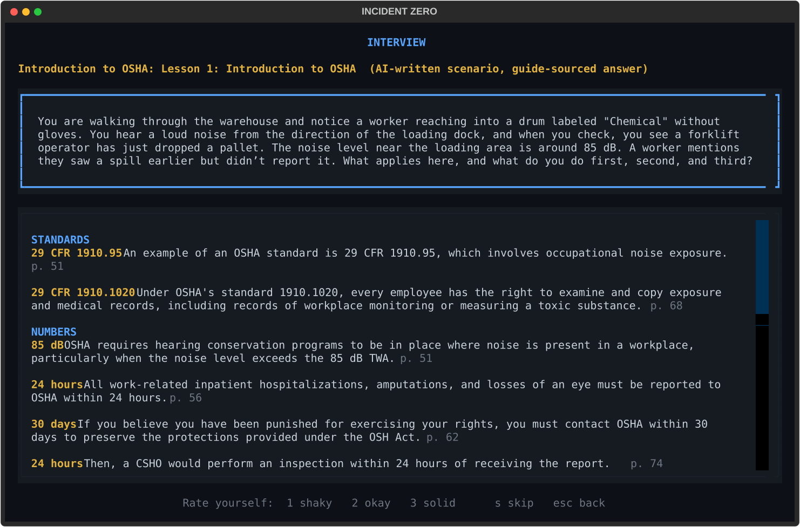
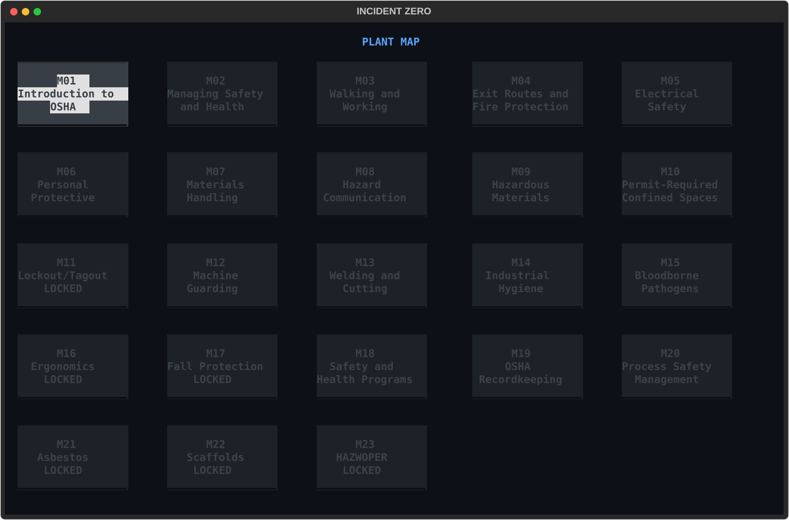
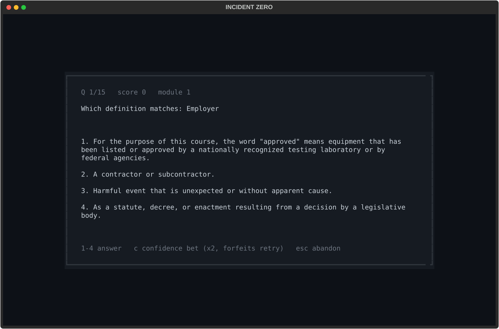

# INCIDENT ZERO — an OSHA 30 dashboard for the terminal

A four-door terminal dashboard built on top of the OSHA 30-Hour General Industry
study guide. It started as a study game and grew, after the exam was passed, into a
working reference for the job: look up a rule, walk an inspection checklist, rehearse
an interview scenario.

Everything on every screen comes from one shared **fact base** mined from the guide
with plain regular expressions — no language model writes any fact, and every fact
carries the page it came from plus a verbatim quote that is checked against that page
at build time. If a number is on a screen, it is on the cited page.

| Door | The one question it answers | Scored? |
|------|-----------------------------|---------|
| **Train** | Do I remember this one fact? | yes — streaks, spaced repetition, a timed exam |
| **Look Up** | What is the rule / number / standard for X? | no |
| **Inspect** | Did I check everything for module N? | no — ticks, Word/PDF export |
| **Interview** | Can I explain what I would do in scenario X? | self-rated only |

The four doors never overlap: Train is closed questions with one right answer,
Interview is open questions where the point is how you explain; Look Up is search,
Inspect is a fixed walk through one module.

## Screens

| | |
|---|---|
|  |  |
|  |  |
|  |  |

## Quick start

```bash
git clone https://github.com/Panbear1983/OSHA30_Incident_Zero.git
cd OSHA30_Incident_Zero
./dashboard.sh                 # first run creates the venv and installs requirements
```

Python 3.11+ is the only prerequisite. The built fact base and question bank ship in
`data/bank.db`, so nothing needs the source PDF to run.

```bash
./dashboard.sh lookup "guardrail height"          # rule lookup from the terminal
./dashboard.sh lookup --plain "hospitalization"   # one line per hit (phone over SSH)
./dashboard.sh export --module 3                  # Word + PDF checklist into exports/
./dashboard.sh export --all
./dashboard.sh status                             # health check
```

## What is inside the fact base

Built from the 966-page guide (23 modules, 56 lessons) and the 10-page sample SDS handout:
1,540 facts in all, and every one of them was found verbatim on its cited page at build time.

| Kind | What it is | How it is found |
|------|-----------|-----------------|
| term | a Key Terms glossary entry with its definition | `Term: definition` lines on the glossary pages |
| threshold | a number with a unit inside a sentence ("42 inches", "85 dBA") | number + unit regex over heading-clean sentences |
| deadline | a threshold in a time unit, in a sentence about reporting or retention | same, filtered by keyword |
| cfr | a sentence that names a `29 CFR 1910.x` standard | cite regex |
| rule | a sentence containing "must" or "shall" | keyword |
| sds | one of the 16 Safety Data Sheet sections | fixed table checked against the handout |

Inspect checklists are the rule facts of each module in page order (1,100 items across
the 23 modules). Interview scenarios are one per lesson (56), with a model answer assembled from that lesson's own standards,
numbers, terms and rules. An optional `./dashboard.sh ai` command can ask a local
Ollama model to write more natural scenario narratives; each one is accepted only if it
quotes at least two supplied facts verbatim and invents no number or standard. The
dashboard never needs Ollama to run.

## Train (the game)

You are the plant inspector. Questions are hazards you catch or miss. Miss twice and the
shift-end debrief writes a full incident report from the exact question you missed, with
the CFR cite, page and source quote. Scoring is a "days without incident" counter, there
is a confidence bet key, a 23-module plant map with mastery-coloured tiles and unlock
rules, and a timed 30-question mock exam. Spaced repetition (FSRS) decides when a
question comes back. Multiple named profiles.

## Rebuilding from the PDF

The PDFs are not in this repository (they are the training provider's copyrighted
material). If you have the guide, put it in the project root under its original name and
run `./dashboard.sh build`; the pipeline is deterministic, so the same PDF reproduces the
same bank byte for byte, and question ids are content hashes so progress survives rebuilds.

## Development

```bash
venv/bin/pip install -r requirements-dev.txt
venv/bin/python -m pytest -q tests          # unit tests + headless Textual playthroughs
scripts/install-hooks.sh                    # arm the secret-scan pre-commit / pre-push hooks
scripts/test-hooks.sh                       # prove the hooks block what they should
venv/bin/python scripts/screenshots.py      # regenerate docs/screenshots/*.svg
```

Textual 7.5, Rich, py-fsrs, PyMuPDF (build only), python-docx (export), LibreOffice for
the PDF step of export when it is installed.

## Credits

Study material: OSHA 30-Hour General Industry Outreach Training Program study guide
(360training). This project is an independent study and reference tool and is not
affiliated with OSHA or the training provider.
